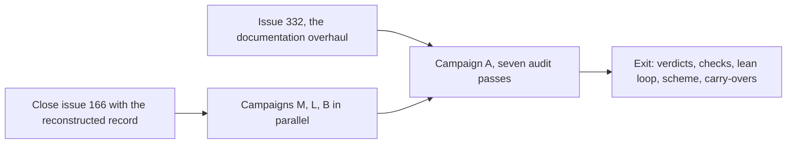

# Whole-codebase audit and authorship scheme (tracking draft)

Status: draft, branch `research/tracking-issue`, of 2026-11-12. This file is
the source of the next tracking issue, the successor of #166. The issue posts
only after #332 closes and this draft is re-read against the final docs tree.
Each change to this file lands as its own commit, so the git history of the
branch shows every shape change. A decided item graduates to the decision
register when it is taken; the posted issue keeps only open state.

## Purpose

Three campaigns under two standing principles. The audit makes each line of
the codebase justify itself against seven defect classes. The authorship
scheme replaces the comprehension budget, Stance item 10 of `docs/design.md`.
The lean loop drives human interventions toward the decisions that need a
human. The principles power the campaigns and outlive them.

## Principle 1: Mechanical Checks First

1. A check that a machine can run is run by a machine, in CI, before an agent
   or the owner reads the result. Agent attention goes only to judgment.
2. Posture default, owner undecided, changeable by comment before campaign M
   lands: deterministic cheap checks gate at once; noisy or expensive checks
   report on a schedule and become gates when they prove stable.
3. The oracle rule: for any identity or correctness claim, the comparison
   harness lands before the code it compares.

## Principle 2: Decisions Stay With the Owner

1. An ambiguity is resolved before a line of code exists. A leg that meets a
   decision its brief does not cover parks the issue with one precise
   question and never chooses.
2. Machines execute and record. They do not decide.

## Campaign Graph

## Campaign M: The Checks

Runs beside the tail of #332. All items are agent-authored glue.

| Item | Work | State |
| --- | --- | --- |
| M1 | Inventory the four checks of `ci.yaml` lines 17 to 30 | planned |
| M2 | deadnix and statix for Nix | planned |
| M3 | go vet, staticcheck, govulncheck for Go | planned |
| M4 | ruff for the two Python suites | planned |
| M5 | luacheck for lua | planned |
| M6 | jscpd for duplication | planned |
| M7 | Citation check: every file and line cite in docs resolves | planned |
| M8 | Lock-age report | planned |
| M9 | Secret scan | planned |

## Campaign L: The Lean Loop

Runs beside the tail of #332.

| Item | Work | State |
| --- | --- | --- |
| L1 | Readiness protocol, the eight ambiguity classes, extends the template of issues #248 and #250 | planned |
| L2 | Readiness gate, default mechanical, explicit not-applicable allowed | planned |
| L3 | Decision catalog in the factory skill: take-alone classes versus park classes | planned |
| L4 | Park shape: one precise question, blocked step named | planned |
| L5 | Intervention log: content over count | planned |
| L6 | Merge policy: owner merges into protected branches, delegation below is wide open | planned |
| L7 | Authorship regime declaration for produced projects | planned |

## Campaign B: The Authorship Scheme

Lands early. A rule change.

| Item | Work | State |
| --- | --- | --- |
| B1 | Amend Stance item 10; decision record names the weekly budget as the lost alternative | planned |
| B2 | The boundary: glue is patterned wiring, and Nix modules are glue; novel has no reference path: new algorithms, the spine, new design | planned |
| B3 | The Socratic contract: ask, probe, review; never draft | planned |
| B4 | The scheme governs audit output: glue fixes by agents, novel fixes by Socratic sessions | planned |

## Campaign A: The Audit

Starts when #332 closes. Method: mechanical results first, evidence packs
second, owner verdicts third, one issue per surviving finding.

| Pass | Seed |
| --- | --- |
| A1 duplicate code | none |
| A2 competing code | the syncthing pair: native module, `flake.nix` lines 436 and 450, beside the container of media-servers |
| A3 competing sources of truth | the keymap table against the binding code |
| A4 waste | none |
| A5 performance | fresh measurement |
| A6 out of date | flake-compat of 2025-12-29, themes of 2026-10-21 |
| A7 vulnerable | none |

Surfaces: Nix 5,816 lines, Go 11,505 lines with no external dependencies, nvim
lua 1,462 lines, fish, tmux, wezterm, `forge-hook.py` 799 lines,
`dispatcher.py` 1,449 lines plus tests, the docs tree, CI, about 40 containers,
the secrets spine.

## Carry-Overs

| Item | Work | Home |
| --- | --- | --- |
| C1 | Remove the wsl and bare outputs, `flake.nix` lines 356, 428, 466, and the nixos-wsl input | campaign A |
| C2 | The syncthing verdict of the source pair | campaign A |
| C3 | Pin about 30 images, version or digest; caddy third-party build decision; Service Law amendment | campaign A |
| C4 | The stage 4 to 7 dispositions folded into the closing record of #166 | opening sequence |
| C5 | Findings #335 and #336 | stay with #332 |

## Decision Log

All decisions of 2026-11-11, taken by the owner in interactive sessions.

| ID | Decision | Source |
| --- | --- | --- |
| D1 | Boundary: Nix module authorship is glue | question round 1 |
| D2 | Socratic contract: ask and review only | question round 1 |
| D3 | Practice arm subsumed by the scheme, no monthly cadence | question round 2 |
| D4 | Pin every image | question round 2 |
| D5 | Campaign A sequences after #332 | question round 2 |
| D6 | Performance pass: no known pain points, measures fresh | question round 2 |
| D7 | Update and close #166 | question round 1 |
| D8 | Check posture undecided, split default recorded | question round 1 |
| D9 | The scheme binds genixis only | lean-loop round |
| D10 | Readiness enforcement undecided, mechanical default recorded | lean-loop round |
| D11 | Intervention recording: content over count | lean-loop round |
| D12 | Owner merges into main and protected branches; below that, wide open | lean-loop round |

## Pending

Undecided defaults: the check posture of principle 1 item 2, and the readiness
enforcement of L2.

The gap review of 2026-11-11 found 18 items. The fold decision is open: each
row enters a campaign table, or is rejected with a reason, when the owner
rules.

| ID | Area |
| --- | --- |
| G1 | Audit-to-check conversion rule: each pass ends with a standing detector |
| G2 | Unmanaged forge state: drift surface and runbook diff |
| G3 | New agent state joins the backup set: intervention log, readiness records, corpora |
| G4 | Brief hierarchy: product charter above issues; feasibility probe class |
| G5 | Lean dogfood acceptance: campaigns M, L, B as the validation run |
| G6 | Enforcement files are spine for review, glue for authorship |
| G7 | Container CVE scan beside pinning; digest pins for exposed services |
| G8 | Host eval matrix in CI, the Darwin eval included |
| G9 | Docs lint of the #332 standing rules; URL check beside the citation check |
| G10 | Token cost telemetry per leg per phase |
| G11 | Crash-resume hardening; park stops versus crash stops in the log |
| G12 | Loop observability surface: queue, stuck legs, log |
| G13 | nvim plugin freshness in the out-of-date pass |
| G14 | Performance measurement protocol: fixed host, repeated runs, standing regression report |
| G15 | Verdicts on rotation cadence and the native runner boundary |
| G16 | Lever: early start of code passes if #332 stalls |
| G17 | Readiness amendment flow for disproven answers |
| G18 | Not-applicable audit of the gate; empty-plaintext agenix check |

Reshapes that wait on #332: the decision register references, the documentation
law references, the workaround vocabulary of #335, the sources sections of
#336.

## Appendix: The Readiness Question Set

The canonical demonstration of the readiness protocol. The owner test brief:
a Minecraft clone in Rust with byte-identical outputs against Java.

A. Reference and product: which exact release and builds are the reference.
What the first milestone delivers. Which subsystems are in scope, in what
sequence, and what is explicitly out.

B. Oracle: which outputs the correctness claim binds to. Which runtime build
is the oracle, with which flags. On which platform the claim must hold. What
corpus defines success, who generates it, and whether the bar is 100 percent.

C. Basis: clean-room or readable decompilation, an owner decision. The asset
policy for copyrighted material.

D. Materials: which jars, seeds, and saves the owner supplies, hash-pinned so
the oracle never moves. Which hardware the runners have.

E. Build rules: the dependency policy. The determinism strategy. The
performance floor per milestone.

F. Loop contract: the authorship regime. The merge delegation below protected
branches. The budgets and stop rules. The decision catalog. The reporting
cadence.
