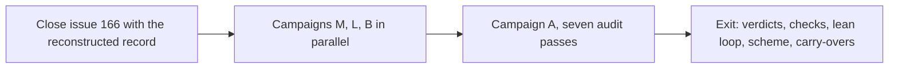

# Whole-codebase audit and authorship scheme (tracking)

Status: final text of 2026-11-13. The owner posts this issue when ready. It takes over the tracking role of issue #166.

## What This Repository Is

Genixis is a Nix flake repository. It declares the configuration of the machines of one owner: two NixOS servers, one NixOS desktop, and one macOS laptop. It also declares about 40 self-hosted services that run in Podman containers on the servers.

A self-hosted Forgejo server hosts the repository. This text calls it the forge. The forge holds the issues and the pull requests.

Most work runs through a factory loop:

1. The owner files an issue. The issue states a problem, a goal, and acceptance criteria.
2. A dispatcher on the services server starts an agent session for the issue. One agent session on one branch is a leg.
3. The leg writes the change, opens a pull request, and posts its record on the issue.
4. A second session reviews the pull request and posts a verdict.
5. The owner reads the verdict and merges. An agent never merges.

Each pull request must pass the gate. The gate is the CI workflow of the repository. It runs checks. A check is a test that a machine runs, for example the formatter or a test suite.

Some parts of the repository form the security spine: the forge hook (the permission layer that reads each forge command), the dispatcher, the secrets, the command allowlists, and the destructive commands of the project tool. Enforcement stays under human control there, no matter who writes the code.

## What This Issue Does

This issue tracks three campaigns and closes with one audit:

1. Campaign M, the checks. CI gains each check that a machine can run.
2. Campaign L, the lean loop. The loop needs as few human stops as possible, and machines make no decisions.
3. Campaign B, the authorship scheme. A new rule decides who writes which code.
4. Campaign A, the audit. Each line of the codebase justifies its place against seven defect classes.

Two standing principles govern all campaigns and outlive them. Issue #166 was the tracking issue before this one. The first leg of this issue reconstructs its unfinished records and closes it.

## Principle 1: Mechanical Checks First

1. A check that a machine can run is run by a machine, in CI, before an agent or the owner reads the result. Agent attention goes only to judgment.
2. Split by cost: a deterministic cheap check gates pull requests from the day it lands. A noisy or expensive check reports on a schedule. It becomes a gate when it proves stable.
3. The oracle rule: when work claims an identity or a correctness result, the comparison harness lands before the code it compares.

## Principle 2: Decisions Stay With the Owner

1. An ambiguity is resolved before a line of code exists. When a leg meets a decision that its brief does not cover, it parks: it stops work and posts one precise question on the issue. It never chooses.
2. Machines execute and record. They do not decide.

## Campaign Graph

## Campaign M: The Checks

Runs first. Agents write all items of this campaign. Each item is glue under the scheme of campaign B. The documentation campaign (issue #332) already landed one new gate sweep: a cited documentation path must resolve, and every documentation file and module readme must be listed in AGENTS.md (pull request #349).

| Item | Work | State |
| --- | --- | --- |
| M1 | Inventory the gate steps of `.forgejo/workflows/ci.yaml`, the path sweep included | planned |
| M2 | deadnix and statix for the Nix files | planned |
| M3 | go vet, staticcheck, and govulncheck for the Go module | planned |
| M4 | ruff for the two Python suites (forge hook and dispatcher) | planned |
| M5 | luacheck for the nvim lua files | planned |
| M6 | jscpd for code duplication | planned |
| M7 | Extend the landed path sweep to the enforceable writing rules: the line-cite ban and the lettered sub-lists | planned |
| M8 | A report on the age of each flake input | planned |
| M9 | A scan for secrets, the empty-plaintext check for agenix files included | planned |
| M10 | A scheduled CVE scan of the pinned container images | planned |

## Campaign L: The Lean Loop

Runs beside campaign M. The goal: an issue that enters the loop ready needs no human until the review. Human attention goes only to decisions.

| Item | Work | State |
| --- | --- | --- |
| L1 | The readiness protocol: eight ambiguity classes (see the appendix), a charter layer, and a spike class. Charter layer: the product-level answers of a project live frozen in one document, and each issue links to it instead of restating. Diataxis, the documentation framework of this repository, governs the form of the charter. Spike class: a technically risky brief gets a timeboxed feasibility probe before its plan freezes | planned |
| L2 | The readiness gate: the dispatcher verifies that each ambiguity class holds an answer or an explicit not-applicable. An issue that lacks one is parked with the missing classes named | planned |
| L3 | A decision catalog in the factory skill (the guide that each leg reads): which decision classes a leg may take alone, and which always park. The catalog carries the spine sentence: gate files, allowlists, and the forge hook are spine for review, even when a machine wrote them | planned |
| L4 | The park shape: one precise question, the blocked step named | planned |
| L5 | The intervention analysis derives from the forge: parks, answers, reversals, and reopened pull requests are read from the issue history at campaign close. The loop writes no second record and creates no new standing state. The content of each stop outranks the count | planned |
| L6 | The merge policy: the owner merges into main and other protected branches. Below protected branches, delegation is wide open | planned |
| L7 | A produced project is any project the factory serves besides this repository. Each produced project declares its authorship regime in its readiness answer: agent-built end to end, or the glue and novel split of campaign B | planned |
| L8 | Cost telemetry: the token cost per leg per phase, derived from harness data, read beside the intervention analysis | planned |
| L9 | Crash-resume hardening: the replan and spawn-marker defects found in the #218 audit. The analysis separates park stops from crash stops, because the two have different cures | planned |
| L10 | Loop observability: verify the board of issue #102 first. When the board is unwired, the surface is agentsview plus the derived record, and no new tool is built | planned |
| L11 | The readiness amendment flow: when a leg disproves a readiness answer mid-run, it files an amendment, the owner approves, and the record versions it | planned |
| L12 | The not-applicable audit: the gate records who answered. Campaign A reads the not-applicable patterns for abuse | planned |

## Campaign B: The Authorship Scheme

Lands early. It is a rule change, not code.

The old rule is the comprehension budget, Stance item 10 of `docs/design.md`: a fixed weekly budget of attention and practice keeps the owner skilled, and once a month the owner writes one task in the same flow as the agents. The new scheme replaces it. The hand-written work itself is the practice, and no separate cadence is set.

Each rule change of this campaign lands as a record in the decision register, `docs/decisions.md`. The register is append-only and holds records 19 to 21 today. A record is written in the adr form: context, decision, options that lost, consequences, status, reopen trigger.

The scheme binds this repository only. Each produced project declares its own regime (L7).

| Item | Work | State |
| --- | --- | --- |
| B1 | Amend Stance item 10 of `docs/design.md`. The decision record in `docs/decisions.md` names the weekly budget as the option that lost | planned |
| B2 | The boundary. Glue is wiring between existing tools that has a pattern to copy, in this repository or upstream. Nix modules are glue, new service containers included, because a pattern exists in the repository. Novel is work without a reference path: new algorithms in the Go module, the security spine, and new design decisions | planned |
| B3 | The Socratic contract for novel work: the agent asks questions, probes with test cases, and reviews drafts. It never writes the implementation, the tests, or the document text | planned |
| B4 | The scheme governs the output of campaign A: a glue fix is written by an agent, a novel fix is written by hand under the contract | planned |
| B5 | One record shape. A workaround record documents a mechanism that fills a gap. Workaround records and register records get the same fields, the adr form defined above. A workaround record keeps four statuses: remove, solve, keep, deferred. A deferred record states its cause, its trigger, and the event that ends the deferral. Records stay in the topic file of their concept. Repository-wide decisions sit in the register, with a pointer left behind | planned |

## Campaign A: The Audit

Starts after campaigns M and L land. The documentation tree is final (issue #332 closed), so the audit reads it as it is. Method: the machine results come first, the evidence of the agents comes second, the verdicts of the owner come third. Each surviving finding gets its own issue.

Exit rule: every pass that finds a defect class ends with a standing detector for that class, so the class cannot quietly return.

Layer rule: agent-facing material lives in the narrowest layer that serves all its consumers. Two layers exist. The global layer is the agent configuration that this repository builds for every host: the global instructions, the global skills, and the global command allowlist. It reaches every project. It stays project-agnostic: it holds no rule that serves one project only. The project layer is the AGENTS.md, the skills, and the allowlist of one repository. The audit checks each skill, each instruction text, each knowledge home, and each agent definition against the rule, in both directions: material that serves only this repository leaves the global layer, and material that every project needs leaves the project layer.

| Pass | Seed |
| --- | --- |
| A1 duplicate code | none |
| A2 competing code | The media host loads syncthing twice: as a native NixOS service and as a container. Both open the same ports |
| A3 competing sources of truth | One fact in two homes: Stance items restated with citations, the runner fact and the token rule each in two files |
| A4 waste | none |
| A5 performance | Fresh measurement under a fixed protocol: a fixed host, fixed commands, repeated runs, a recorded baseline. The pass leaves a standing regression report behind |
| A6 out of date | The flake-compat input (locked 2025-12-29), the themes input (locked 2026-10-21), and the nvim plugin set |
| A7 vulnerable | Two verdict items: the rotation cadence of tokens and keys against `docs/secrets.md`, and the native runner that executes pull-request workflows with a token |
| A8 backup-set verification | The dispatcher state on the services server sits in the backup set, wherever the runbook defines it |
| A9 layer audit | Each skill, instruction text, knowledge home, and agent definition sits in its right layer, global or project-local, under the layer rule. Seeds: the global mandate of the writing skills against the genixis scope of the writing law; the placement of the diataxis and adr skills; the reach of the factory, forgejo, project, and search skills against the produced-project plan |

Surfaces: the Nix tree (5,816 lines, plus the binding row list of `lib/keymap.nix`), the Go module of the project tool (11,505 lines, no external dependencies), the nvim lua tree (1,462 lines), the fish, tmux, and wezterm configuration, `forge-hook.py` (799 lines), `dispatcher.py` (1,449 lines, plus tests), the documentation tree of fourteen files, CI, about 40 containers, the secrets spine, the forge-native state that the repository does not build (branch protection, labels, runner settings, and the hand-set humanLabels keys), and the global agent layer that this repository builds: the global instructions, the global skills, and the global allowlist.

## Carry-Overs

Open work that earlier plans left. Each item lands inside a campaign of this issue.

| Item | Work | Home |
| --- | --- | --- |
| C1 | Remove the wsl and bare outputs of the flake. They configure a Windows host and a server template, and no machine builds them. The nixos-wsl input goes with them | campaign A |
| C2 | The syncthing verdict: decide which of the two instances (see A2) holds the data, and remove the other | campaign A |
| C3 | Pin the container images. About 30 of 40 track the latest tag. Prefer a digest pin for the services that the internet can reach. The caddy image comes from a third-party build and needs its own decision. The Service Law of `docs/containers.md` gains the rule | campaign A |
| C4 | Reconstruct the stage 4 to 7 records of issue #166 from the issue stream, and close it with that record | opening sequence |
| C5 | The ruled findings of the documentation campaign, listed below | campaigns A and B |
| C6 | Issue #345: the gate evaluates neither the darwin configuration nor the standalone homes | campaign M |

## Findings Ruled From the Documentation Campaign

The documentation campaign (issue #332) rewrote the documentation tree file by file and closed on 2026-11-13. Its review left seven findings open. The owner ruled on each finding the same day.

| ID | Finding | Ruling |
| --- | --- | --- |
| P1 | Deferred records carry no cause, no guard, and no verdict. The rule and the record taxonomy disagree | Resolved by B5: deferred becomes a status with required fields |
| P2 | The ssh-route record of `docs/services.md` names a removed cause, holds the verdict keep as a stated design, and states no reason and no trigger | Re-verdict: a stated design with reason and review trigger, or remove |
| P3 | The why sections of `docs/project.md`, `docs/cli.md`, and `docs/terminal-aesthetic.md` name no lost options and no reopen events | Ride with B5: bring the three sections to the shared shape. Repository-wide decisions move to the register, with a pointer left behind |
| P4 | Restatements work against the one-source law: one fact must live in one home | One home per fact, pointers elsewhere. The criteria map keeps its map role |
| P5 | The register records carry a Reason line inconsistently, against the adr craft, where context and consequences are due fields | Adopt the shared shape of B5 for new register records. The register is append-only, so old records stay |
| P6 | Register record 3 names a closed issue as its reopen event | Accepted as recorded, no change |
| P7 | Warts: the forge-hook file name covers a third of its file, hive memory appears once with no definition, and several sentences run past the writing limits | Fix in the documentation pass of campaign A |

## Decision Log

The owner took these decisions in interactive sessions. The decisions of the documentation campaign live in the register (records 19 to 21), not here: one source holds each fact. A decided item graduates to the register when it is taken. This issue keeps only open state.

| ID | Decision | Source |
| --- | --- | --- |
| D1 | Boundary: Nix module authorship is glue | 2026-11-11, round 1 |
| D2 | Socratic contract: ask and review only | 2026-11-11, round 1 |
| D3 | The practice arm is subsumed by the scheme. No monthly cadence is set | 2026-11-11, round 2 |
| D4 | Pin every container image | 2026-11-11, round 2 |
| D5 | The audit sequences after the documentation campaign. It closed on 2026-11-13, so the audit now waits on campaigns M and L | 2026-11-11, round 2 |
| D6 | The performance pass knows no pain points. It measures fresh | 2026-11-11, round 2 |
| D7 | Update and close issue #166 | 2026-11-11, round 1 |
| D8 | Check posture: split by cost | ruled 2026-11-13 |
| D9 | The scheme binds genixis only | 2026-11-11, lean-loop round |
| D10 | Readiness enforcement: the mechanical gate | ruled 2026-11-13 |
| D11 | Intervention recording: the content of each stop outranks the count | 2026-11-11, lean-loop round |
| D12 | The owner merges into main and other protected branches. Below that, delegation is wide open | 2026-11-11, lean-loop round |
| D13 | The gap list folds in full: every item enters a campaign. The loop creates no new standing state. Records derive from the forge. The charter layer rides diataxis. The campaigns M, L, and B are themselves the acceptance run of the lean claim | 2026-11-13, rulings round |
| D14 | Workaround records and register records get one shared shape (P1, P3, P5) | 2026-11-13, rulings round |

## Pending

1. The post: the owner posts this issue when ready.
2. The home switch: the owner switches the home, so the diataxis and adr skills and the changed search skill reach the sessions.
3. The first tutorial walk: the owner walks the machine rebuild walkthrough of `docs/tutorial.md`, which fills in its walk date.

## Method

One campaign runs as one branch, under one rule set, with one pull request at its end. The documentation campaign proved this single-pass method. The per-file issue method of that campaign was cancelled mid-run.

Evidence cites files and symbols. Documentation text carries no line-number citations. The owner decides, and the sessions record. Each campaign posts its closing record as a comment on this issue.

The lean claim is accepted or rejected by content: every stop of a leg during campaigns M, L, and B traces to a named ambiguity class or a named infrastructure fault, and each closing record shows the classes that caused stops and their fixes.

## Appendix: The Readiness Question Set

The readiness protocol of L1 demands that a brief answers eight classes of questions before work starts. The owner gave this test brief: make a Minecraft clone in Rust, with byte-identical outputs compared to Java. The questions below turn that brief into work that needs no human until the review. Each group is one ambiguity class.

A. Reference and product: which exact release and builds are the reference. What the first milestone delivers. Which subsystems are in scope, in what sequence, and what is explicitly out.

B. Oracle: which outputs the correctness claim binds to. Which runtime build is the oracle, with which flags. On which platform the claim must hold. What corpus defines success, who generates it, and whether the bar is 100 percent.

C. Basis: clean-room or readable decompilation, an owner decision. The asset policy for copyrighted material.

D. Materials: which jars, seeds, and saves the owner supplies, hash-pinned so the oracle never moves. Which hardware the runners have.

E. Build rules: the dependency policy. The determinism strategy. The performance floor per milestone.

F. Loop contract: the authorship regime. The merge delegation below protected branches. The budgets and stop rules. The decision catalog. The reporting cadence.
