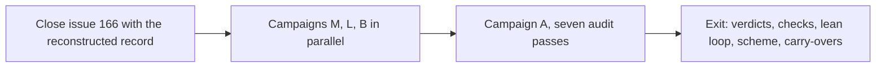

# Whole-codebase audit and authorship scheme (tracking draft)

Status: draft, branch `research/tracking-issue`, rulings of the owner recorded
on 2026-11-13. This file is the source of the next tracking issue, the
successor of #166. The documentation overhaul closed on 2026-11-13 through
pull requests #347 and #349, so the gate that held this draft is gone: the
issue can now be written and posted. Each change to this file lands as its own
commit, so the git history of the branch shows every shape change. A decided
item graduates to the decision register when it is taken; the posted issue
keeps only open state.

## Purpose

Three campaigns under two standing principles. The audit makes each line of
the codebase justify itself against seven defect classes. The authorship
scheme replaces the comprehension budget, Stance item 10 of `docs/design.md`.
The lean loop drives human interventions toward the decisions that need a
human. The principles power the campaigns and outlive them.

## Principle 1: Mechanical Checks First

1. A check that a machine can run is run by a machine, in CI, before an agent
   or the owner reads the result. Agent attention goes only to judgment.
2. Posture, decided on 2026-11-13: split by cost. Deterministic cheap checks
   gate pull requests from the day they land; noisy or expensive checks report
   on a schedule and become gates when they prove stable.
3. The oracle rule: for any identity or correctness claim, the comparison
   harness lands before the code it compares.

## Principle 2: Decisions Stay With the Owner

1. An ambiguity is resolved before a line of code exists. A leg that meets a
   decision its brief does not cover parks the issue with one precise
   question and never chooses.
2. Machines execute and record. They do not decide.

## Campaign Graph

## Campaign M: The Checks

Runs first. All items are agent-authored glue. The docs campaign already
landed one new gate sweep: cited docs paths must resolve, every docs file and
module readme must be listed in AGENTS.md (PR #349, ci.yaml).

| Item | Work | State |
| --- | --- | --- |
| M1 | Inventory the gate steps of ci.yaml, the path sweep included | planned |
| M2 | deadnix and statix for Nix | planned |
| M3 | go vet, staticcheck, govulncheck for Go | planned |
| M4 | ruff for the two Python suites | planned |
| M5 | luacheck for lua | planned |
| M6 | jscpd for duplication | planned |
| M7 | Extend the landed path sweep into the enforceable standing rules: the line-cite ban and the lettered sub-lists | planned |
| M8 | Lock-age report | planned |
| M9 | Secret scan, the empty-plaintext agenix check included | planned |
| M10 | Container CVE scan on the pinned images, scheduled | planned |

## Campaign L: The Lean Loop

Runs beside campaign M.

| Item | Work | State |
| --- | --- | --- |
| L1 | Readiness protocol: the eight ambiguity classes of the appendix, the charter layer (product-level answers frozen in one document; issues link, never restate; diataxis governs the form), and the spike class (a timeboxed feasibility probe before a risky plan freezes) | planned |
| L2 | Readiness gate, decided on 2026-11-13: mechanical. Each class holds an answer or an explicit not-applicable; the dispatcher parks an issue that lacks one, with the missing classes named | planned |
| L3 | Decision catalog in the factory skill: take-alone classes versus park classes. It carries the spine sentence: gate files, allowlists, and the hook are spine for review even when machine-written | planned |
| L4 | Park shape: one precise question, blocked step named | planned |
| L5 | Intervention analysis derived from the forge: parks, answers, reversals, and reopened pull requests are read from the forge history at campaign close. The loop writes no second record and creates no new standing state. Content over count | planned |
| L6 | Merge policy: owner merges into protected branches, delegation below is wide open | planned |
| L7 | Authorship regime declaration for produced projects | planned |
| L8 | Cost telemetry: token cost per leg per phase, derived from harness data, read beside the intervention analysis | planned |
| L9 | Crash-resume hardening: the replan and spawn-marker dispositions of #218 ride here; the analysis separates park stops from crash stops | planned |
| L10 | Loop observability: verify the board of #102 first; if it is unwired, the surface is agentsview plus the derived record, and no new tool is built | planned |
| L11 | Readiness amendment flow: a leg that disproves an answer mid-run files an amendment, the owner approves, the record versions it | planned |
| L12 | Not-applicable audit: the gate records who answered; campaign A reads the not-applicable patterns for abuse | planned |

## Campaign B: The Authorship Scheme

Lands early. A rule change. The decision record lands in the append-only
register of `docs/decisions.md`, written with the adr skill; the register
holds records 19 to 21 today.

| Item | Work | State |
| --- | --- | --- |
| B1 | Amend Stance item 10 of docs/design.md; the register record names the weekly budget as the lost alternative | planned |
| B2 | The boundary: glue is patterned wiring, and Nix modules are glue; novel has no reference path: new algorithms, the spine, new design | planned |
| B3 | The Socratic contract: ask, probe, review; never draft | planned |
| B4 | The scheme governs audit output: glue fixes by agents, novel fixes by Socratic sessions | planned |
| B5 | Record-shape alignment, decided on 2026-11-13: the adr field set becomes the base shape for workaround records; four statuses, remove, solve, keep, deferred; deferred requires cause, trigger, and the event that ends the deferral; the placement law stays, records live with their concept in topic files, repository-wide decisions sit in the register with pointers | planned |

## Campaign A: The Audit

Starts after campaigns M and L land. Method: mechanical results first,
evidence packs second, owner verdicts third, one issue per surviving finding.
The docs campaign closed its own findings, so this audit reads the final
fourteen-file tree. Exit rule: every pass that finds a defect class ends with
a standing detector for that class, so the class cannot quietly return.

| Pass | Seed |
| --- | --- |
| A1 duplicate code | none |
| A2 competing code | the syncthing pair: native module beside the container of media-servers |
| A3 competing sources of truth | the restatement-plus-citation pattern: Stance items restated, the runner fact and the token rule in two files each (parked finding 4 of the docs campaign) |
| A4 waste | none |
| A5 performance | fresh measurement under a fixed protocol: fixed host, fixed commands, repeated runs, recorded baseline; the pass leaves a standing regression report behind |
| A6 out of date | flake-compat of 2025-12-29, themes of 2026-10-21, the nvim plugin set |
| A7 vulnerable | two verdict items: token and key rotation cadence against docs/secrets.md; the native runner executing pull-request workflows with a token |
| A8 backup-set verification | the dispatcher state on services sits in the backup set, wherever the runbook defines it |

Surfaces: Nix 5,816 lines plus the row list of `lib/keymap.nix`, Go 11,505
lines with no external dependencies, nvim lua 1,462 lines, fish, tmux, wezterm,
`forge-hook.py` 799 lines, `dispatcher.py` 1,449 lines plus tests, the docs
tree of fourteen files, CI, about 40 containers, the secrets spine, and the
forge-native state that the repository does not build: branch protection,
labels, runner settings, the hand-set humanLabels keys.

## Carry-Overs

| Item | Work | Home |
| --- | --- | --- |
| C1 | Remove the wsl and bare outputs, flake.nix, and the nixos-wsl input | campaign A |
| C2 | The syncthing verdict of the source pair | campaign A |
| C3 | Pin about 30 images, version or digest, digest preferred for the exposed services; caddy third-party build decision; Service Law amendment | campaign A |
| C4 | The stage 4 to 7 dispositions folded into the closing record of #166 | opening sequence |
| C5 | The parked findings of the docs campaign, ruled below | campaign A and B |
| C6 | Issue #345: evaluate the darwin configuration and the standalone homes in the gate | campaign M |

## Parked Findings of the Docs Campaign, Ruled

From the structure window of 2026-11-13; rulings of the owner, same day.

| ID | Finding | Ruling |
| --- | --- | --- |
| P1 | Deferred records carry no cause, guard, or verdict; rule and taxonomy disagree | Resolved by the record-shape alignment of B5: deferred becomes a status with required fields |
| P2 | The ssh-route record of services.md: removed cause, verdict keep as a stated design, no reason, no trigger | Re-verdict: stated design with reason and review trigger, or remove |
| P3 | The why sections of project.md, cli.md, and terminal-aesthetic.md lack lost options and reopen events | Ride with B5: bring the three sections to the adr shape; repository-wide decisions move to the register with a pointer |
| P4 | The restatement-plus-citation pattern against the one-source law | One home per fact, pointers elsewhere; the criteria map keeps its map role |
| P5 | The register minimum shape against the adr skill: context and consequences due, Reason lines inconsistent | Adopt the adr shape for new register records; the register is append-only, old records stay |
| P6 | Register record 3 names a closed issue as its reopen event | Accepted as recorded, no change |
| P7 | Warts: the forge-hook file name, the undefined hive memory, sentences past the STE limits | Fix in the campaign A docs pass |

## Decision Log

Decisions of the owner in interactive sessions. The decisions of the docs
campaign live in the register (records 19 to 21), not here: one source holds
each fact.

| ID | Decision | Source |
| --- | --- | --- |
| D1 | Boundary: Nix module authorship is glue | 2026-11-11, round 1 |
| D2 | Socratic contract: ask and review only | 2026-11-11, round 1 |
| D3 | Practice arm subsumed by the scheme, no monthly cadence | 2026-11-11, round 2 |
| D4 | Pin every image | 2026-11-11, round 2 |
| D5 | Campaign A sequences after the docs campaign; it closed on 2026-11-13, campaign A now waits on campaigns M and L | 2026-11-11, round 2 |
| D6 | Performance pass: no known pain points, measures fresh | 2026-11-11, round 2 |
| D7 | Update and close #166 | 2026-11-11, round 1 |
| D8 | Check posture: split by cost | 2026-11-11 open, ruled 2026-11-13 |
| D9 | The scheme binds genixis only | 2026-11-11, lean-loop round |
| D10 | Readiness enforcement: the mechanical gate | 2026-11-11 open, ruled 2026-11-13 |
| D11 | Intervention recording: content over count | 2026-11-11, lean-loop round |
| D12 | Owner merges into main and protected branches; below that, wide open | 2026-11-11, lean-loop round |
| D13 | The gap table folds in full: every item enters a campaign; the loop creates no new standing state, records derive from the forge; the charter layer rides diataxis; the lean acceptance is the M, L, B run itself | 2026-11-13, rulings round |
| D14 | The adr field set becomes the base shape for workaround records and register records alike (P1, P3, P5) | 2026-11-13, rulings round |

## Pending

1. The writing pass: the final issue text through technical-english and
   semantic-diff, the diataxis and adr skills loaded, then the post.
2. Owner actions left by the docs campaign: the home switch that activates
   the diataxis, adr, and changed search skills; the first tutorial walk that
   fills the walk date of docs/tutorial.md.

## Method and Records

The #332 campaign cancelled its per-file issue method mid-run: one branch,
one rule set, one pull request per series, rulings in window comments, worked.
This issue adopts that method per campaign. Evidence cites files and symbols,
never line numbers in doc text. The owner decides; sessions record. Each
campaign posts its closing record as a comment on the posted issue. The lean
acceptance runs with the campaigns: every stop of a leg traces to a named
ambiguity class or a named infrastructure fault, and the closing record shows
the classes that caused stops and their fixes.

## Appendix: The Readiness Question Set

The canonical demonstration of the readiness protocol. The owner test brief:
a Minecraft clone in Rust with byte-identical outputs against Java.

A. Reference and product: which exact release and builds are the reference.
What the first milestone delivers. Which subsystems are in scope, in what
sequence, and what is explicitly out.

B. Oracle: which outputs the correctness claim binds to. Which runtime build
is the oracle, with which flags. On which platform the claim must hold. What
corpus defines success, who generates it, and whether the bar is 100 percent.

C. Basis: clean-room or readable decompilation, an owner decision. The asset
policy for copyrighted material.

D. Materials: which jars, seeds, and saves the owner supplies, hash-pinned so
the oracle never moves. Which hardware the runners have.

E. Build rules: the dependency policy. The determinism strategy. The
performance floor per milestone.

F. Loop contract: the authorship regime. The merge delegation below protected
branches. The budgets and stop rules. The decision catalog. The reporting
cadence.
